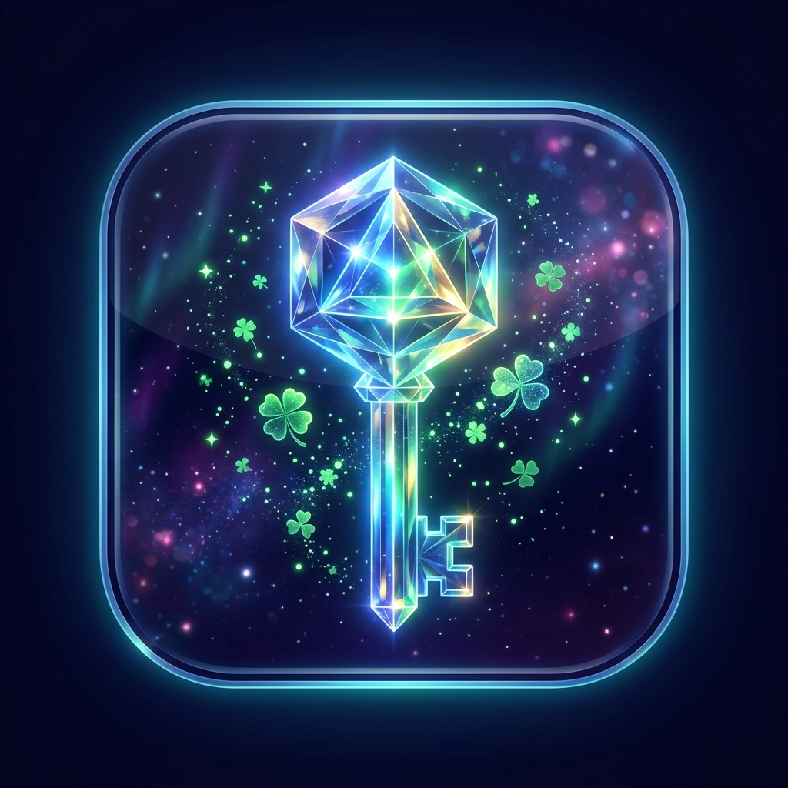

# 🌟 LucKey Prism 공식 앱 아이콘 프리뷰

새롭게 디자인 및 적용된 **LucKey Prism**의 공식 3D 앱 아이콘입니다.

---

### 🎨 디자인 특징
1. **빛나는 다면체 크리스탈 열쇠 (LucKey Key)**
   - 중심부에 배치된 고해상도 프리즘 크리스탈 열쇠 모티브
   - 차원과 행운의 문을 여는 LucKey 유니버스의 핵심 심볼
2. **신비로운 밤하늘 성운 & 오로라 (Cosmic Starlight & Nebula)**
   - 딥 인디고 & 바이올렛 우주 배경 위로 은은하게 반짝이는 별무리와 오로라 보케
3. **네잎클로버 & 세잎클로버 생체 발광 입자 (Luminescent Clovers)**
   - 루시 AI와 루시+의 상징인 에메랄드 빛 네잎·세잎 클로버가 은은하게 부유
4. **글래시 iOS 스퀘어클 (Squircle) 엣지**
   - 모바일 홈 화면 및 PWA 환경에서 가장 돋보이는 모던 프리미엄 앱 아이콘 질감

---

### 📱 적용된 규격
- **웹/소셜 공유**: 512×512 (`/public/app-icon.png`, OpenGraph 메타 연동)
- **iOS 홈 화면**: 180×180 (`/public/apple-touch-icon.png`)
- **PWA & 안드로이드**: 192×192, 512×512 (`/public/icon-192.png`, `/public/icon-512.png`)
- **브라우저 파비콘**: 64×64 (`/public/favicon.png`)
